

  

  

  
  
  

---

## 👨‍💻 About me

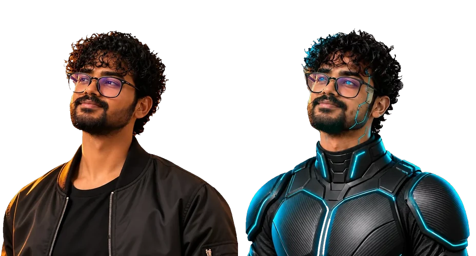

I'm a **Full-Stack Developer & AI Engineer** with 3+ years of experience building production web, mobile, and AI applications — currently at **CitraTek Inc.**, where I own backend microservices, GraphQL APIs, and an AI-powered semantic search feature built with RAG.

- 🔭 &nbsp;Currently building **MindMate AI** — an open-source AI assistant app, live on web, Android & iOS
- 🧠 &nbsp;Specialised in **Java · Spring Boot · React · TypeScript · Python · AWS · GenAI/RAG**
- 🏆 &nbsp;**1,000+ DSA problems solved** across LeetCode (546) and GeeksforGeeks (469) — Institute Rank 1 on GFG
- ☁️ &nbsp;**AWS Certified** ×3 — AI Practitioner · Developer Associate · Cloud Practitioner
- 🎓 &nbsp;Master's in Information Systems Technologies — Wilmington University
- 🤝 &nbsp;Open to collaborating on full-stack and AI-powered products

---

## ✦ Highlights

  
  
  
  

---

## 🚀 Projects I Have Worked On

  <a href="https://mindmate-si.vercel.app">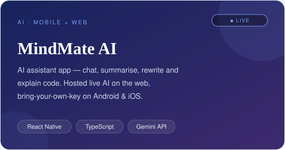</a>
  <a href="https://aryanmoulich.vercel.app"></a>

  <a href="https://edu-friened-12.web.app/login">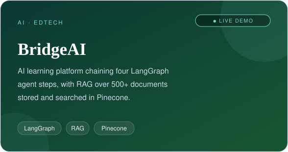</a>
  <a href="https://github.com/Aryanch1/Proton">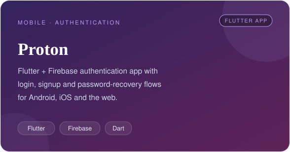</a>

**Project links**

| Project | What it is | Links |
| --- | --- | --- |
| **MindMate AI** | AI assistant app (React Native · Expo · TypeScript): chat, summarize, rewrite, explain code — bring-your-own-key on mobile, live AI built into the web version | [▶ Live app](https://mindmate-si.vercel.app) · [Code](https://github.com/Aryanch1/Mindmate-SI) |
| **BridgeAI** | AI learning platform: LangGraph orchestration chaining 4 agent steps with RAG over 500+ documents in Pinecone | [▶ Live app](https://edu-friened-12.web.app/login) · [Code](https://github.com/Aryanch1/EduFriend) |
| **Proton** | Flutter + Firebase authentication app with login, signup, and password recovery flows | [Code](https://github.com/Aryanch1/Proton) |
| **Smart Hotel Reservation Agent** | Python AI agent that searches, compares, and books across 4 sources | [Code](https://github.com/Aryanch1/smart_hotel_agent) |
| **Portfolio** | My developer portfolio — projects, experience, and certifications | [▶ Live site](https://aryanmoulich.vercel.app) · [Code](https://github.com/Aryanch1/Aryanmouli-Cherupalli-Portfolio) |

---

## 🛠️ Tech stack

**Languages**

**Frontend & Mobile**

**Backend & APIs**

**AI & GenAI**

**Databases & Data**

**Cloud & DevOps**

**Tools & IDEs**

---

## 📊 GitHub stats

  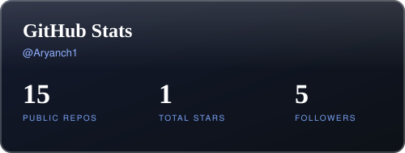
  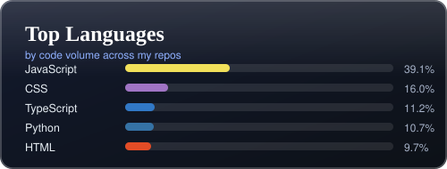

🏅 <strong>GitHub achievements:</strong> Pull Shark · Pair Extraordinaire · YOLO · Quickdraw

  

  

---

## 🏅 Coding profiles

  
  

  

  <a href="https://www.geeksforgeeks.org/profile/aryanmov1z0">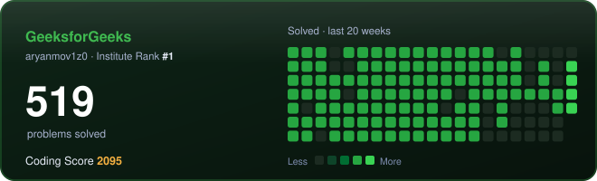</a>

- **LeetCode:** 546 solved (151 Easy · 277 Medium · 118 Hard) · 365-day badge
- **GeeksforGeeks:** 469 solved · Coding Score 1995 · Institute Rank 1 · 485 POTDs

---

  

